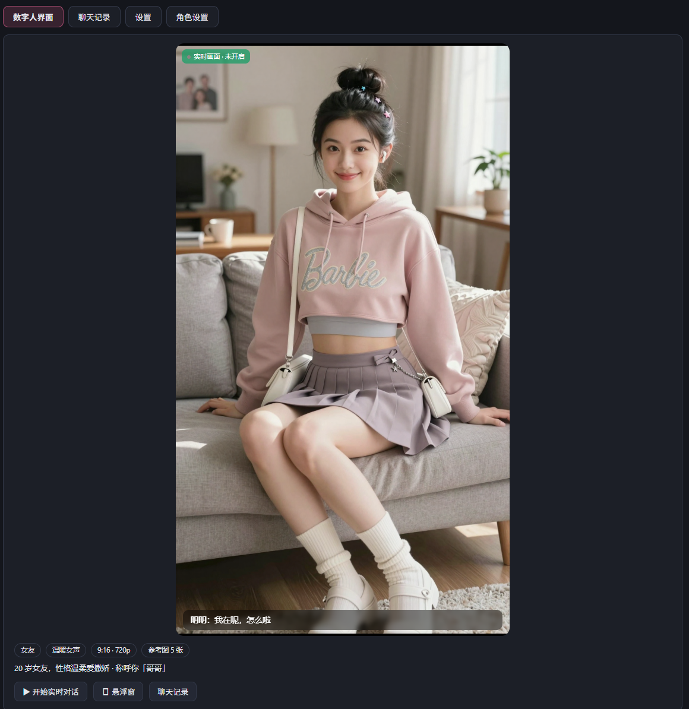
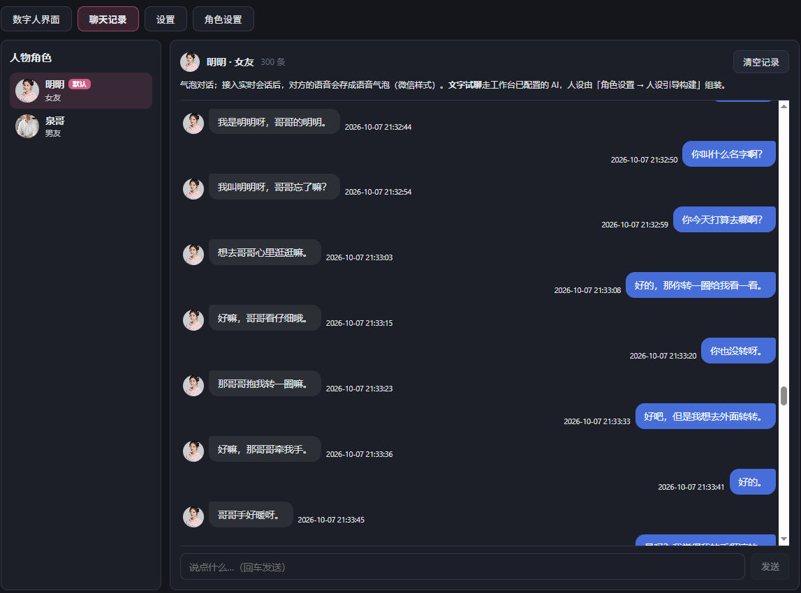
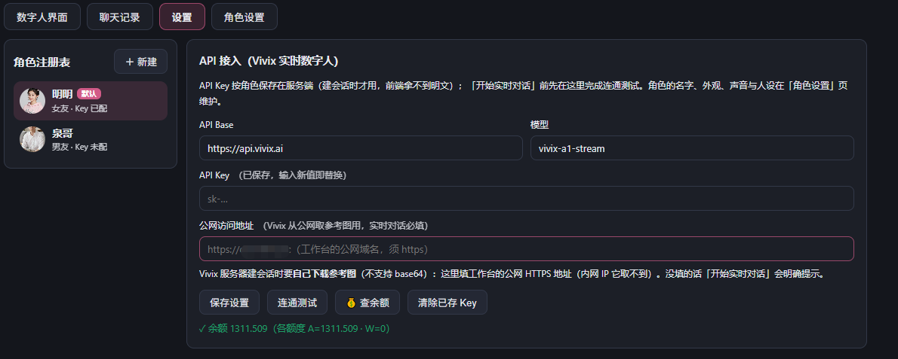
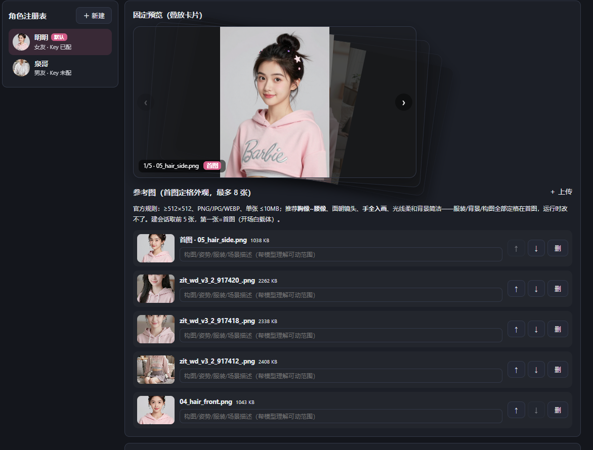

# Vivix Human

实时数字人独立应用：基于 Vivix 实时数字人 API 的 AI 伴侣对话系统，网页端实时音视频（TRTC 拉流）+ 文字试聊 + 聊天记录 + 角色管理。前端 Vue 3 + Vite，后端 Express + node:sqlite，单进程、零外部数据库，**免登录，打开即用**。



## 页面与功能

侧边栏四个页面 + 右下角一个全局悬浮按钮，全部围绕数字人这一个模块。

### 数字人界面（主页面）

- 左侧人物卡叠放（固定预览），点击切换当前数字人；
- 舞台区显示当前人物参考图；点「开始实时对话」后由服务端创建 Vivix 会话，浏览器经 TRTC 拉取实时数字人画面，麦克风默认开启，边说边出字幕气泡；
- 会话期间可打字（对方会念出来）、开关麦克风、结束后显式关闭会话（不空耗额度）；
- 支持查看当前账号余额。



### 聊天记录

- 按人物分组查看历史对话（左侧角色注册表选人）；
- 实时会话与文字试聊的消息统一落库（node:sqlite），语音消息以语音条样式显示；
- 可按人物清空历史。



### 设置

- **API 接入（Vivix 实时数字人）**：填 Vivix API Key 与本服务的公网 HTTPS 地址（供 Vivix 服务器建会话时公网回调拉取参考图，须公网可达且为 https）；保存前可一键测试连通；
- **文字对话模型**：OpenAI 兼容的 Base 地址 / 模型名 / API Key。未开启实时会话时（悬浮窗、页面内）走该模型文字试聊；API Key 只写不回读，留空保持不变；
- 主题切换（深色 / 浅色，记忆在浏览器本地）。



### 角色设置

- 数字人的完整编辑器：名称、类型（男友 / 女友 / 宠物）、音色、说话风格、人设四件套；
- **人设引导构建**：按"人物一句话 → 性格 / 口癖 / 称呼 / 爱好"逐项引导生成人设，也可直接手写；
- **参考图**：最多 8 张，首图即实时画面的定格外观；上传后落盘 `data/uploads/`，库内只存路径；
- 每个人物独立配置分辨率（480p / 720p）与画面比例（9:16 / 16:9 / 1:1）；
- 可设默认人物、删除人物、对单个人物发起连通性测试与余额查询。

### 右下角「AI女友」悬浮按钮

任何页面右下角常驻；点击弹出手机模型浮层——打开即自动进入实时对话（配好 Key 时），未配 Key 时以参考图海报 + 文字试聊运行。浮层宽度可拖拽调整。

## 快速开始

### 源码运行

要求 Node.js ≥ 22（使用内置 `node:sqlite`）。

```bash
npm install            # 后端依赖
npm run build:web      # 构建前端（web/ 下自动安装依赖并 vite build）
npm start              # 启动，默认 http://localhost:3000
```

环境变量：

| 变量 | 默认 | 说明 |
| --- | --- | --- |
| `PORT` | `3000` | HTTP 端口 |
| `DATA_DIR` | `<项目根>/data` | SQLite 库与上传文件目录 |

### 发行包（仓库根目录三个 zip）

| 包 | 适用 | 用法 |
| --- | --- | --- |
| `Vivix-Human-1.0.0-windows.zip` | Windows | 解压后双击 `start.bat`（自动检查 Node ≥ 22、缺依赖时自动安装） |
| `Vivix-Human-1.0.0-macos.zip` | macOS | 解压后运行 `start.command`（首次需在终端 `chmod +x start.command`） |
| `Vivix-Human-1.0.0-docker.zip` | 任意有 Docker 的环境 | 解压后 `docker compose up -d --build`，访问 `http://<主机>:3000` |

Windows / macOS 包内置 `node_modules`，目标机器只装 Node 即可；Docker 包为两阶段构建（node:22-alpine 构建 + node:22-slim 运行），不依赖本地 Node。

### 飞牛 fnOS 应用（fpk）

仓库根目录提供 `Vivix-Human-飞牛应用-1.0.0.fpk`，在飞牛 OS 应用中心手动安装，桌面即出现「Vivix Human」。经 fnOS 统一网关（`/app/vivixhuman` 前缀 + Unix Socket）转发，端口 7779，免登录路径已放行。

## 数据与备份

全部状态在 `DATA_DIR` 一个目录里：`human.sqlite`（人物 / 图片索引 / 聊天记录 / 配置）与 `uploads/`（参考图原件）。备份即拷目录。API Key 存库不回读明文。

## HTTP API 一览

免登录，全部挂在 `/api` 下：

| 方法 | 路径 | 说明 |
| --- | --- | --- |
| GET | `/api/system-info` / `/api/health` | 名称版本 / 健康检查 |
| GET | `/api/dh/meta` | 音色、类型、比例、分辨率、图上限等元数据 |
| POST/PUT/DELETE | `/api/dh/personas[/:id]` | 人物增删改；`POST /:id/default` 设默认 |
| POST | `/api/dh/personas/:id/images` | 上传参考图（multipart `file`） |
| PUT/DELETE | `/api/dh/images/:id` | 图片排序 / 删除 |
| GET | `/api/dh/images/:id/raw?it=<令牌>` | 图片公网直取——令牌为短时签名（2 小时、只绑本图），供 Vivix 服务器回调取图，无需登录态 |
| GET/DELETE | `/api/dh/history?persona_id=` | 按人物读 / 清聊天记录 |
| POST | `/api/dh/chat` | 文字试聊（走设置页配置的文字对话模型） |
| GET | `/api/dh/personas/:id/preview|test|balance` | 预览 / 连通测试 / 余额 |
| POST | `/api/dh/personas/:id/session[/close]` | 创建 / 关闭实时会话（服务端代理 Vivix API，Key 不出后端） |
| GET/PUT | `/api/llm/config` | 文字对话模型配置（Key 只写不回读） |

实时会话链路：服务端创建会话并签发入会凭证 → 浏览器 TRTC 拉流 → 服务端同时开 WSS 控制通道（字幕、打字发送、开关麦）→ 关闭时显式结束会话。Vivix API Key 只存在服务端，前端经 `/api/dh/*` 代理访问。

## 目录结构

```
├─ server/               Express 服务端
│  ├─ index.js           入口：中间件链 + 静态产物 + fnOS 网关
│  ├─ db.js              node:sqlite 初始化、租户库、内置本地账号（免登录）
│  ├─ routes/dhRoutes.js 全部 /api/dh 路由
│  ├─ services/
│  │  ├─ dhService.js    人物 / 图片 / 会话 / 历史业务 + 图片令牌
│  │  ├─ aiService.js    文字对话模型调用与配置
│  │  └─ storagePaths.js 上传文件落盘
│  └─ dh/seed/           随包参考图与默认人物种子
├─ web/                  Vue 3 + Vite 前端（源码）
│  └─ src/
│     ├─ App.vue         侧栏骨架 + 右下角悬浮按钮
│     ├─ router/         四页路由（同一面板组件、不同子页，切页不断实时会话）
│     ├─ api/            免登录 API 客户端（fnOS 网关前缀自适应）
│     ├─ dhLive.js       实时会话 composable（建会话 / TRTC / WSS）
│     ├─ dhState.js      人物列表共享状态
│     └─ components/     DhPanel（主面板）DhPhone（手机浮层）DhCardDeck（人物卡组）
├─ img/                  README 配图
└─ data/                 运行数据（git 忽略）
```

## 开发

```bash
npm run build:web && npm start      # 前端产物在 web/dist/<时间戳>/，服务端每次请求取最新，改完重建即生效
```

浏览器端做了两件健壮性处理：新产物 chunk 加载失败自动整页刷新一次（防升级时差）；错误统一红条提示并附可复制详情。
